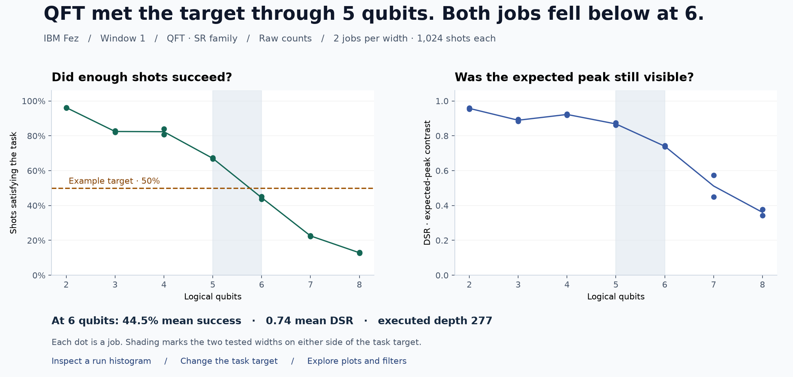
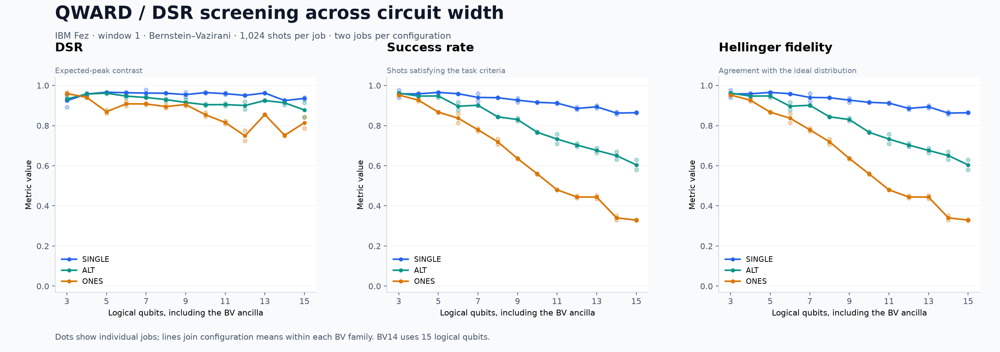
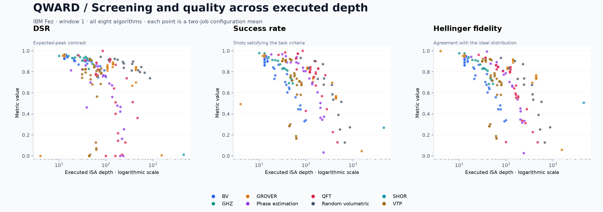
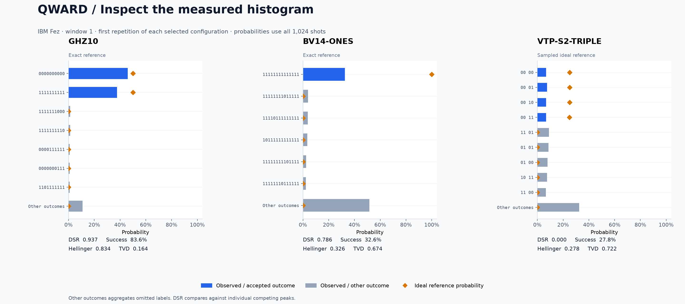

# IBM Quantum experiment dashboard plan

Working draft, 4 November 2026. Interface and figures are open for iteration.

## Purpose and current evidence

The dashboard now lives in the independent top-level `dashboard/` project. Its static build shares the QWARD GitHub Pages deployment at `dashboard/`. Sphinx provides a discovery link. The first release presents the current results for a professor-facing demonstration, then supports repeated measurements on named IBM backends.

The validated snapshot contains 404 unique jobs on `ibm_fez`. It includes the original 30-job pilot, the 30-job pilot repeat, and the 344-job first campaign window. Window 1 covers 172 configurations, two repetitions per configuration, 1,024 shots per job, optimization level 3, and transpiler seed 11. Its billed QPU usage is 692 seconds. The combined exporter reports zero errors, zero skipped records, and 48 warnings. Of those warnings, 34 concern sampled references, 10 concern calibration changes in the pilot repeat, and four concern QuantumSpecific failures in the original pilot.

The source is `qward/examples/papers/dataset_out/dataset.csv` and its export report. Preserve campaign, window, and backend identity throughout filtering and aggregation. Future figures must disclose their selected snapshot and last measurement date.

## Landing page · How far can I use this raw circuit?

Start with **Choose an algorithm**. Offer all eight algorithms on the selected chip and show the latest completed window and measurement date. Inside each algorithm, name the circuit family in plain language and show the task it performs. Open one family at a time. Default to the QFT SR example for the first demonstration. Here “raw” means the observed job counts after the recorded transpilation and execution settings, before any dashboard-side correction or pooling.

1. **Read the result.** Show one sentence with the last tested setting meeting the selected task requirement and the next tested setting that missed it, when the measurements support that summary. Directly below it show the requirement, the metric, both repetitions, shot count and execution context. A developer should be able to quote the result with its conditions from this screen.
2. **Check the signal.** Put task performance and DSR side by side on the same width or depth axis. In plain language, the first answers “Did enough shots satisfy my task?” and DSR answers “How clearly did the expected outcomes stand above the strongest competing outcome?” The requirement applies to the selected task metric alone. Offer the task's random-guess baseline where defined. A missed target can still contain useful signal.
3. **Inspect a run.** Select either side of the boundary, then a repetition, to see its observed histogram with expected labels and reference probabilities. Offer the neighbouring configuration for side-by-side comparison. Carry the exact selection into **Explore plots**.
4. **Explore plots** opens the editable axes, metrics, chips, families, dates and repetition filters. Changing the task target recalculates the summary immediately and labels it as a custom target. Reset restores the published view. Browsing or hiding points in Explore must leave the published measurement scope visible and must never silently redefine its boundary.

### Choose the question that defines the boundary

Use the practitioner questions from *Choosing a Quantity for an Execution Requirement* in the limitation-metrics manuscript (LaTeX table `tab:gqm`). After the chip and algorithm selection, ask **What do you need this circuit to do?** Default the QFT SR example to **Return an accepted answer**. Keep the selected question above the headline, width/depth plot and histogram. Changing questions keeps the same runs and loads that question’s metric, threshold direction, reference and histogram annotations. If no target has been chosen for that question, show the measurements and invite the developer to set one before drawing a boundary.

| Developer question | What determines the result | What to highlight in the selected run |
|---|---|---|
| Did enough shots return an accepted answer? | Success rate, the observed fraction in the defined answer set (R1). For “How much better than guessing?”, offer chance-corrected success only with an explicit, justified null model. | Shade every accepted bar and show their combined count over all shots. Show the chance baseline when used. |
| Do the expected peaks dominate competitors? | DSR, the contrast between the average accepted-label probability and the strongest individual competing probability (R1). | Mark the accepted average and the strongest competitor. Show the number of accepted labels, measured bits and shots. |
| Does any candidate stand out before I know the answer? | Top-two observed contrast and the per-job rank test (R0). Derive contrast from complete counts and show the recorded rank status, significance level and p-value. The manuscript’s separated-group procedure needs its own implementation and validation. | Mark the two leading counts and any tie. A resolved rank supports a separation claim under the sampling assumptions. Application verification is a separate step. |
| Do the accepted answers occur in the proportions my task requires? | Coarse TVD or coarse Hellinger distance against justified target weights (R1). Display the weights used by the exported metric. | Show a bin for each accepted answer and one bin for all remaining mass. For GHZ this exposes imbalance between the two accepted strings. |
| How close is the whole output to the ideal distribution? | Full TVD or Hellinger comparison with a complete reference (R2). Name the representation and direction, e.g. lower TVD or higher Hellinger fidelity. Identify sampled ideal references. | Overlay ideal probabilities on the observed histogram. Compute the comparison on the full support before display-only grouping. |

Every view states what evidence it requires. When the reference or justified weights are missing, keep the question visible with the reason it is unavailable. Estimator questions about observable deviation, energy, positive-eigenspace success and reported uncertainty belong to R3 or Estimator diagnostics and require their own records. The current Sampler campaign supplies counts. Operational fidelity and inverse-return questions require additional protocol runs (R4). Calibration-based predictions stay in their own view.

A changed question can yield a different last usable setting. Preserve a threshold across representations only when the conversion preserves the per-job decision for the same attribute and reference. For example, TVD at most 0.20 means TVD similarity at least 0.80. Switching from success to DSR loads a separate requirement. Treat DSR as ordinal within a fixed answer set, outcome space and sampling design. Across widths, label DSR points as descriptive per-configuration checks and show the changing context. A shared DSR cutoff across widths or families needs justification.

Keep both job values visible. If an uncertainty-aware decision is requested, show the interval method and level for that metric, and mark a threshold-overlapping interval **Inconclusive**. A missing interval leaves that decision unavailable. Apply conversions to each job before reporting summaries and identify their weighting. Pooled counts answer a separate question from an equal-job summary.

### Reading a boundary from the measurements

A boundary belongs to a backend, window, raw circuit family, ordered sweep and explicit task requirement. Start with an editable example such as “at least half the shots return an accepted answer” for a recovery task. Offer distribution agreement when the task is to reproduce a distribution. Record metric, direction, numerical target, and profile version with every published summary. Confirm defaults with the research team across windows 2 and 3 before presenting them as monthly benchmarks.

Classify each tested setting from the individual jobs. For window 1, label it **Meets target** when both repetitions meet the inclusive requirement, **Below target** when both miss, and **Mixed** when they disagree. Incomplete jobs or missing required metrics mean **Insufficient evidence**. Display the observed fractions, including close calls. These labels describe this sample. They do not establish a future job's success probability.

Show a single bracket only for an ordered, comparable sweep with a passing prefix and a failing suffix. Use the actual endpoints and identify gaps in coverage. If all pass, say “met target through the largest tested setting.” If all miss, say “below target at every tested setting.” For reversals, split repetitions or missing evidence, show the sequence of tested settings with their individual statuses. For a single point, report that measurement alone. Changing the plot to depth preserves the original sweep and annotates the endpoints with their measured depths. A depth-limit claim requires its own comparable ordered sweep.

| Algorithm | What the developer can compare |
|---|---|
| GHZ | Width sweep with both expected bitstrings visible. Offer distribution agreement to expose imbalance between them. |
| Bernstein–Vazirani | Width within a fixed secret pattern (SINGLE, ALT or ONES). Label measured bits and ancilla separately. |
| QFT | Start with the ordered SR width sweep. Separate the other preparation and input variants. |
| Phase estimation | Counting-register width within each phase family. Explain the accepted tolerance beside the ideal distribution. |
| Grover | Width for matched search tasks, such as S3-1 through S5-1. Keep the marked fraction and chance level visible. |
| vTP | V and S series separately with payload fixed. Show individual settings when a larger circuit recovers after a dip. |
| Random volumetric | Compare depths at fixed width. Keep the circuit instance and seed visible and identify where the sweep has a single sampled setting. |
| Shor | Show the N15-M3 result and “one configuration tested.” More sizes are needed to bracket a limit. |

### Proposed first screen

With the **illustrative 50% success target**, SR5 returned accepted answers on 67.4% and 66.7% of shots at executed depth 161. SR6 returned 43.8% and 45.2% at depth 277. Mean DSR at SR6 was still 0.74. A developer seeking an answer on at least half their shots would pick SR5 from this sweep. Someone investigating whether the expected peak survives has a reason to open the SR6 histogram. This is one Fez window.

## DSR as the first screening view

When an accepted-answer set is available, feature Differential Success Rate as a quick check of expected-peak dominance. Make it the primary result when the developer selects that question and a companion measure for task success. Use the existing `f.fidelity.dsr` field and its QWARD Michelson definition. Let a be the mean observed probability over the accepted outcome set and b the largest observed probability of an outcome outside that set. DSR is the contrast `(a - b) / (a + b)`, clipped to the supported range, with the implementation's boundary handling.

DSR consumes observed counts and expected outcome labels. It can avoid generating a full ideal distribution when those labels are readily available. Present that practical advantage with a short explanation and a later reproducible benchmark. Success rate, chance-corrected success, and coarse similarities are companion measures with separate names.

Keep success rate and distribution metrics available next to DSR. BV14-ONES is an instructive example from window 1. Its mean DSR is approximately 0.815 while mean success is 0.329. Its expected outcome remains prominent relative to individual competing outcomes while substantial probability lies elsewhere. Show this relationship directly in the histogram explorer.

Use existing peak-mismatch and rank-evidence fields with their definitions. Multi-peak expected distributions, ties, and finite shot counts need explicit explanations. Define task-specific screening thresholds after reviewing repeated windows. The initial interface displays continuous values and their evidence.

The benchmark phase should measure the DSR operation, full-distribution metric evaluation with an available reference, and ideal-reference construction separately. Include warm-up, repeated timings, median and spread, input size, machine details, and cached versus uncached reference construction. Current records do not contain isolated DSR timing. A numerical speedup claim requires that measurement.

## Explore plots · controls and visual grammar

- Global filters select backend, campaign, window or date, algorithm, family, configuration, and repetition.
- The horizontal axis selector offers logical qubit count, measured bit count, executed ISA depth, and two-qubit gate count. Start with separate width and depth views so units are clear.
- The vertical axis selects DSR, success rate, chance-corrected success, Hellinger fidelity, raw TVD, or TVD similarity. Default to the metric of the selected question.
- A comparison mode shows aligned metric panels with the same selected circuits. Label raw TVD as lower-is-better and similarity measures as higher-is-better.
- Use `a.num_qubits` for logical width, `a.num_clbits` for measured width, and `b.depth` for the stored executed ISA depth. Avoid displaying idle device wires as algorithm width. BV14 has 14 measured bits and 15 logical qubits including its ancilla.
- Show individual repetitions and their configuration means. Two repetitions provide a range of observed values, not a reliable estimate of variability across months. Any shot-based confidence intervals should identify their method and what they measure.
- Connect points within an ordered algorithm family. Use scatter plots across heterogeneous algorithms, with a logarithmic depth toggle.
- Stable colours identify algorithms or families. Hover information includes configuration, metrics, logical and measured width, ISA depth, two-qubit gate count, shots, repetition, job ID, and execution time.

## Initial image previews

These PNGs use the actual window 1 export. They are static figure proposals for layout review. Their styling and chosen default selections can change before dashboard implementation.

### Width view

The initial selection is Bernstein–Vazirani, separated into SINGLE, ALT, and ONES. DSR, success rate, and Hellinger fidelity share a logical-qubit horizontal axis. Pale dots represent individual jobs and lines show configuration means. For deterministic BV references, success and Hellinger fidelity coincide in these data.

### Depth view

All eight algorithms appear as configuration means against executed ISA depth. DSR, success rate, and Hellinger fidelity occupy aligned panels. This comparison is available under Explore plots after the developer has seen the selected family’s result.

### Histogram explorer

Three selected individual jobs demonstrate a two-peak target, a dominant expected outcome with diffuse error, and a degraded dynamic circuit. These are GHZ10, BV14-ONES, and VTP-S2-TRIPLE. Reference markers show theoretical probabilities, including the sampled ideal reference for dynamic vTP. Bars use the original shot total. The displayed other-outcomes bin preserves omitted mass.

Regenerate the previews from the repository root with `uv run python scripts/preview_ibm_dashboard.py`.

## Histogram interaction design

Selecting a point opens that run's histogram and metadata. Provide selectors for repetition and campaign window, plus a clearly labelled pooled-counts option. Reference data comes from the run's frozen `prepared.json` and follows the record's multi-register bit ordering.

Display observed probabilities and an ideal-reference overlay. Offer counts as an alternative scale. Highlight the accepted success set independently from the ideal probability values, because the two can differ for algorithms such as phase estimation. Hover details show the bitstring, observed count, observed probability, ideal probability, accepted status, and difference from the reference.

Keep relevant expected labels visible, including labels with zero observed counts. Support search and pagination when the expected set is large. A top-outcomes view aggregates omitted outcomes into a labelled bin and reports both observed and reference mass in it. Preserve normalization against all shots. Label sampled references and distinguish unavailable references from zero ideal probability.

Provide side-by-side run comparison, fixed category ordering across an animation, a log-probability toggle, and PNG/SVG/data downloads. Plot captions carry configuration, backend, shots, job, repetition, and reference type. Clicking an expected label should highlight its contribution to success and its role in DSR.

## Animated visual library and interface

Use **Apache ECharts** for the proposed interactive dashboard, with its version pinned and its browser bundle distributed with the documentation assets. Its data transitions support animated changes to scatter plots and bars. Its universal-transition features support linked drill-down between aggregate selections and individual runs. This updates the earlier Plotly proposal to fit the emphasis on animation across views.

The standalone project uses browser JavaScript and CSS. Its Python build reads only the job and reference tables and writes a compact local script containing the dashboard snapshot. ECharts reads it directly in the browser.

Animate changes to backend, window, selected metric, histogram, and highlighted run. Use stable configuration and outcome IDs so transitions preserve object identity. Provide a play/pause timeline for discrete measured windows and monthly observations. Keep axis limits stable during playback when possible and stop playback when the user inspects a run. Intermediate frames are visual interpolation between observations, while actual measurement dates remain visible.

Default update animations should take approximately 300–500 ms. Honour reduced-motion preferences and provide an explicit animation toggle. Provide keyboard controls, descriptive text, distinguishable markers or patterns, and accessible data tables. The scientific export offers a frozen frame with its complete caption.

Library references are the [ECharts data-transition guide](https://apache.github.io/echarts-handbook/en/how-to/animation/transition/), [universal transitions](https://echarts.apache.org/handbook/en/basics/release-note/5-2-0/), and [accessibility guide](https://echarts.apache.org/handbook/en/best-practices/aria/).

## Additional dashboard views

| View | Proposed content |
|---|---|
| Algorithm boundaries | Choose the chip, algorithm and family. Read the observed result and task target, then inspect either endpoint. |
| Campaign details | Latest execution date, profile version, backend, coverage, jobs, billed QPU usage, and warnings |
| DSR screening | Width/depth metric panels, expected-peak interpretation, mismatch and rank evidence |
| Histogram explorer | Observed and reference probabilities, accepted labels, run comparison, and timeline |
| Predictions | Observed errors against M1, M1-mixture, and M2, with residuals |
| Hardware context | Actual physical layout, used-qubit calibration summaries, and changes before execution |
| History | Per-configuration trends across pilots, windows, and monthly campaigns |
| Coverage | Tested ranges, sample sizes, excluded data, missing metrics and documented reasons |

Show the current vTP S2 and V3 anomalies with their layouts. They are candidates for follow-up. Window 1 establishes association with a selected execution context, while later experiments are needed to identify the cause.

## Monthly measurement profile

Retain the full 172-configuration research profile while completing windows 2 and 3. The smaller monthly profile below is provisional and should be finalized using their repeatability results.

| Algorithm | Candidate configurations | Count |
|---|---|---|
| GHZ | GHZ3, GHZ8, GHZ10, GHZ12, GHZ14, GHZ16 | 6 |
| BV | Widths 3, 8, and 14, each with SINGLE, ALT, and ONES | 9 |
| vTP | V2/V3/V4/V5 and S1/S2/S3/S5, using SINGLE payloads | 8 |
| QFT | SR3, SR5, SR8 | 3 |
| Phase estimation | PE-T3, PE-T6, PE-T8 | 3 |
| Grover | S3-1, S4-1, S5-1 | 3 |
| Random volumetric | RV2-D2, RV4-D4, RV5-D10, RV8-D8 | 4 |
| Shor | SHOR-N15-M3 | 1 |
| Total | Two repetitions at 1,024 shots | 37 configurations, 74 jobs |

Estimated Fez usage is approximately 2.5–3 QPU minutes before a budget margin, based on the observed billing. Check access and available allowance per instance and estimate each additional backend separately. The current research window used 11 minutes 32 seconds on Fez. The account's actual allowance governs execution.

Each profile version fixes the configuration list, shots, repetitions, transpiler settings, and metric definitions. Add a backend selector to execution plans and output paths. Cross-backend comparisons use matching profile versions and tasks, while preserving each backend's actual layout, depth, and calibration. Display measured operating ranges and their dates with any proposed performance threshold.

## Cloud execution, history, and publication

Start with manual GitHub Actions execution, then enable a configurable monthly schedule. Secrets hold `IBM_QUANTUM_TOKEN` and the instance identifier. Variables hold backend selections, profile version, shots, repetitions, batch concurrency, and the QPU usage budget.

The workflow loads a selected profile, checks access and remaining allowance, reuses eligible QuantumSpecific cache entries, and prepares fresh calibration snapshots and transpiled circuits. It then submits within the configured limit and recovers results using saved IDs.

Persist submission intent, manifests, and accepted job IDs in versioned durable storage. A dedicated results branch is a candidate. Reconcile interrupted or uncertain submissions before retrying. Separate submission from bounded collection invocations so long IBM queues can survive runner expiration. Workflow artifacts can supplement the archive. Avoid relying on an expiring dependency cache as the sole copy of a job journal.

After validation, export a dataset snapshot and explicitly trigger the documentation build. Publish a defined set of scientific fields and provenance, with credentials and account identifiers confined to execution configuration. Retain old snapshots so historical plots remain reproducible. Missing or failed monthly measurements receive explicit status rather than an invented score.

## Delivery sequence and review gates

1. Review the boundary preview first. Ask a developer to identify the last setting meeting their goal, the first miss, and how to inspect that run. Then review the supporting figures.
2. Prototype the algorithm and question selectors, boundary summary, linked run histogram and expandable plot editor in ECharts using the current export. Review its motion, controls, tooltips, and readability.
3. Link the independent dashboard from Sphinx and publish its own build alongside the documentation. Reuse the dataset exporter and QWARD metric implementations.
4. Add history, prediction, hardware, and multi-backend views using the same validated data contract.
5. Finalize the monthly profile after windows 2 and 3, then verify a manual cloud run and interruption recovery.
6. Enable the agreed schedule and budgets after the manual workflow is validated.

Check that the example 50% success target brackets SR5 and SR6 and that a changed target recalculates from both jobs at every setting. Switch from success to DSR on the same jobs and check that the question, target, histogram annotations and headline change together. Remove the ideal reference and verify that full-distribution agreement becomes unavailable while answer-set questions remain usable. Exercise all-pass, all-below, reversal, mixed, missing and single-point cases.

Acceptance requires matching the 404-job current export and the 344-job first window, displaying all 172 window 1 configuration pairs, and preserving metric values and histogram probability mass. Check multi-target GHZ, deterministic BV, sampled dynamic vTP, and phase estimation's distinct success set. Test zero-count expected outcomes, aggregated tails, multi-register labels, missing references, missing metrics, and interrupted submissions.

Review the page at professor-presentation size and on a smaller screen. Confirm filters and chart selection stay linked, animation can be paused, exported figures identify their data, public assets contain only the intended fields, and documentation builds require completed data alone.
