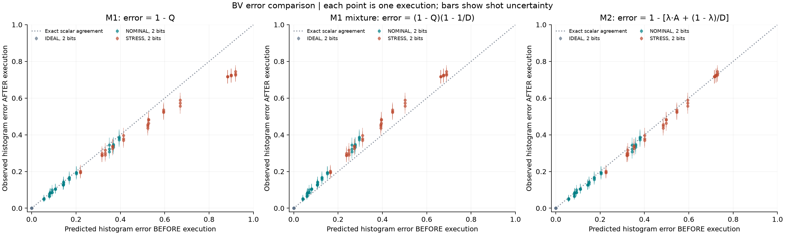
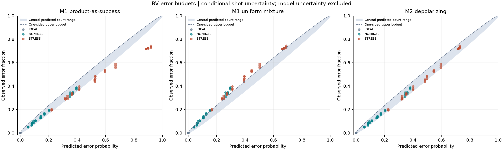

# BV noisy-simulator baseline

Completed 225 executions (460,800 shots): 25 configurations × 3 profiles × 3 seeds, with 2,048 shots per execution.

## Predicted error versus final histogram error

For a primary BV circuit, the ideal distribution is a point mass at the known answer t. Consequently, the empirical histogram error is exactly `E_observed = TVD(counts/N, ideal) = 1 - counts[t]/N`. No ideal state simulation is needed. This is the observed error estimate; the stored interval represents its finite-shot uncertainty.

Let Q be the calibration product saved before execution. We compare two explicit hypotheses against that same observed error:

- **M1-success:** `E_predicted = 1 - Q`. This treats Q as a prediction of target success.
- **M1-mixture:** `E_predicted = (1 - Q)(1 - 1/D)`, with D=2^m. This treats Q as visibility in a global uniform-output mixture. At two measured bits, this is `0.75*(1-Q)`.
- **Observed − predicted:** the signed difference between histogram error and predicted error. The table expresses this in **percentage points (pp)**: positive means more error than predicted, negative means less. This difference is not a sigma score; uncertainty-standardized scores are reported separately below.

These quantities are available for every primary BV run in [error_comparison.csv](error_comparison.csv), together with counts, error intervals, interval inclusion, and identifiers linking to the frozen prediction. Injected-fault controls are excluded from this scalar comparison because their hardware reference differs from the nominal task reference.

- **M2-depolarizing:** each native gate with average infidelity r and dimension d scrambles the register with probability `p = r·d/(d−1)`; polarization `λ = Π(1−p)`; readout applies independent bit flips A. Then `P(t) = λ·Π(1−r_ro) + (1−λ)/D` and `E_predicted = 1 − P(t)`. Like M1 it aggregates per-instruction calibration only, but it can never predict more error than a scrambled output (`1 − 1/D`). Older records predate M2; their M2 value is recomputed from the archived pre-run snapshot (`m2_source` column). M2 has no fitted parameters.

| Noise | Bits | L | Observed error | M1 product | Obs − M1 (pp) | M1 mixture | Obs − mix (pp) | M2 depolarizing | Obs − M2 (pp) |
|---|---:|---:|---:|---:|---:|---:|---:|---:|---:|
| IDEAL | 2 | 0 | 0.00% | 0.00% | +0.00 | 0.00% | +0.00 | 0.00% | +0.00 |
| IDEAL | 2 | 2 | 0.00% | 0.00% | +0.00 | 0.00% | +0.00 | 0.00% | +0.00 |
| IDEAL | 2 | 8 | 0.00% | 0.00% | +0.00 | 0.00% | +0.00 | 0.00% | +0.00 |
| IDEAL | 2 | 32 | 0.00% | 0.00% | +0.00 | 0.00% | +0.00 | 0.00% | +0.00 |
| NOMINAL | 2 | 0 | 7.52% | 7.67% | -0.15 | 5.75% | +1.77 | 7.86% | -0.34 |
| NOMINAL | 2 | 2 | 10.05% | 10.92% | -0.87 | 8.19% | +1.86 | 11.25% | -1.20 |
| NOMINAL | 2 | 8 | 16.41% | 17.13% | -0.72 | 12.85% | +3.56 | 17.58% | -1.17 |
| NOMINAL | 2 | 32 | 34.86% | 37.07% | -2.21 | 27.80% | +7.06 | 36.13% | -1.27 |
| STRESS | 2 | 0 | 27.76% | 30.51% | -2.75 | 22.88% | +4.87 | 30.07% | -2.32 |
| STRESS | 2 | 2 | 37.33% | 41.79% | -4.46 | 31.34% | +5.99 | 40.19% | -2.85 |
| STRESS | 2 | 8 | 52.56% | 59.71% | -7.15 | 44.78% | +7.78 | 54.60% | -2.04 |
| STRESS | 2 | 32 | 72.49% | 90.08% | -17.59 | 67.56% | +4.93 | 72.23% | +0.26 |

**Reading STRESS, L=8:** the mixture model predicted 44.78% error; the observed error was 52.56%. Their difference is **+7.78 percentage points**. The mixture prediction underestimated the wrong-answer fraction by that amount. This is not a sigma score or a relative percent change. The product prediction for the same row was 59.71%, giving -7.15 percentage points; that model overestimated error.

Each row averages three secrets × three seeds × the layouts in scope. `L` is the number of forward padding layers before their inverse; larger L increases noise exposure while preserving the ideal BV answer. `STRESS` uses the strongest simulated noise profile. See [error_comparison_by_depth.csv](error_comparison_by_depth.csv). A row average does not have a single per-run sigma value.

### One actual saved run

Configuration `BVCP2-low_predicted_error-ALT-L032`, noise `NOMINAL`, repetition 0: the expected answer `01` occurred **1347/2048** times.

- Before execution: Q=0.631128, so the product hypothesis predicted **36.89% error**.
- After execution: `1 - 1347/2048` gives **34.23% histogram error**.
- Difference: **-2.66 percentage points**. The mixture hypothesis predicted **27.67%**, with residual **+6.56 pp**.
- The stored 99.9778% sampling interval is **[30.41%, 38.19%]**. Product estimate inside: `True`; mixture estimate inside: `False`. These are interval-inclusion diagnostics, not new jointly calibrated hypothesis tests, and they do not include calibration or model uncertainty.

Points above the diagonal have more observed error than predicted; points below have less. Vertical bars are the stored per-run sampling intervals. Equal scalar error does not imply equal histogram shape: `mixture_prediction_histogram_tvd` separately measures TVD(observed histogram, predicted histogram). The existing `model_status` tests that full mixture distribution, rather than only whether the two error scalars agree.

## Error budget and uncertainty screening

The new screening compares the observed **number of wrong BV answers** with an exact binomial count range calculated from each frozen prediction and the shot count. This is a predictive range for counts, whereas the earlier Clopper–Pearson interval estimates an unknown probability from the observed counts. Neither includes model uncertainty.

For each primary run, error_comparison.csv now includes `*_budget_residual_shot_z`, central predicted count bounds, a separate one-sided `*_budget_upper_count_budget`, exact tail probabilities, and range/budget flags. The signed z-score is `(observed_error - predicted_error)/sqrt(predicted_error*(1-predicted_error)/shots)`. It uses the predicted shot variance, not the plug-in observed variance used in the earlier illustrative calculation. Decisions use exact bounds; a zero-variance prediction has a null z-score and is still tested exactly.

These retrospective diagnostics use alpha=6.6137566e-05 per claim: 0.05 divided by seven claims per primary run and 108 primary runs. Seven claims means a central range and an upper budget for each of the three models, plus one prespecified-target test against uniform background. The adjustment applies to these new checks, not a combined guarantee with legacy tests or future repeated looks. The analysis policy was selected after inspecting this baseline, so these results are exploratory rather than a confirmatory validation.

For the example above, **701 wrong answers** were observed. The product prediction's central range is **669–843**, with upper budget **839**; its signed residual is **-2.49 predicted shot standard deviations**. The mixture range is **487–648**, upper budget **645**, and residual **+6.64**. Which prediction is used changes the conclusion.

| Noise | Runs | Above product upper budget | Below product central range | Above mixture upper budget | BV target resolved vs uniform |
|---|---:|---:|---:|---:|---:|
| IDEAL | 36 | 0 | 0 | 0 | 36 |
| NOMINAL | 36 | 0 | 1 | 22 | 36 |
| STRESS | 36 | 0 | 21 | 33 | 27 |

Passing an upper budget does not establish useful signal: an overly pessimistic prediction can pass every run. The separate target test compares the known BV answer with a uniform-background probability of 1/D using an exact upper binomial tail. Uniform background is an explicit hypothesis, not a calibrated per-bin hardware-noise model. An unresolved target remains inconclusive at these shots, not proven absent. Diagnostic controls are excluded from this BV-specific screen.

`uncertainty_review_action` is an exploratory review suggestion based on the product prediction and target test. Unexpectedly low or high error requests prediction review; independently inspect the upper-budget flag for unexpectedly poor runs. Every raw histogram is retained. Legacy 80% success / 0.10 TVD decisions have been removed from current code and exports. Historical raw records retain their original fields for provenance; the current report does not use them.

Before this becomes a hardware acceptance rule, estimate prediction discrepancy from separate calibration windows, freeze the resulting predictive bound, and check coverage and false dismissals on new windows. Three simulator seeds under one stationary noise model per profile do not calibrate drift or hardware prediction uncertainty. A per-bin noise-only screen additionally requires a validated background probability for that bin.

## Outcome classes: combining histogram signal with prediction consistency

The histogram decides whether this run's answer is usable (target resolved above the 1/D background). The M2 prediction decides whether that outcome was expected (observed wrong-answer count inside M2's central count range). `outcome_class` in error_comparison.csv combines the two:

| | Target resolved | Target unresolved |
|---|---|---|
| Within M2 range | `success` | `expected_failure` |
| Above M2 range (more error) | `degraded_success` | `anomalous_failure` |
| Below M2 range (less error) | `success_better_than_predicted` | `unresolved_better_than_predicted` |

| Noise | expected_failure | success | success_better_than_predicted |
|---|---:|---:|---:|
| IDEAL | 0 | 36 | 0 |
| NOMINAL | 0 | 36 | 0 |
| STRESS | 9 | 26 | 1 |

Range status here includes shot noise only. In this simulator the noise is generated from the same calibration the predictor reads, so the classes test the aggregation model, not hardware predictivity. On hardware, widen the range by a model-discrepancy term estimated on separate calibration windows before using these classes as decisions.

## Design and provenance

Scope `smoke`: 25 configurations; measured widths [2]; layouts ['low_predicted_error']; 108 primary BV executions and 117 diagnostic-control executions. Primary BV patterns are ONES/ALT/SINGLE × L=0/2/8/32. The `contrasting_predicted_error` layout has twice the error rates. Both circuit constructions and result tracking are shared with the IBM runner.

| Profile | Average 1Q infidelity | Average 2Q infidelity | Symmetric readout flip |
|---|---:|---:|---:|
| IDEAL | 0.000% | 0.000% | 0.000% |
| NOMINAL | 0.100% | 1.000% | 2.000% |
| STRESS | 0.500% | 5.000% | 8.000% |

The noise model is built from the same synthetic Target used by the predictor. Aer converts average gate infidelity to local depolarization strength; virtual RZ has no noise, readout is symmetric and independent, and thermal/idle noise is disabled. Routing and native decomposition are included. GenericBackendV2 is a local synthetic device, not a live IBM calibration snapshot.

Methods: {'matrix_product_state': 9, 'stabilizer': 216}. Stabilizer is used for BV and Clifford controls; matrix-product-state handles the π/6 rotation diagnostic. No dense statevector or density-matrix method is used. RNG seed base: 20261022; exact per-execution seeds are in raw records. Repetitions share stationary calibration and must not be described as hardware drift windows.

Every prediction and calibration snapshot was archived before its local simulation. All 75 prepared-record/QPY/noise-model hashes have been verified. See the top-level manifest, raw JSON records, QPY files, and noise-model JSONs. The analysis reads those saved counts without rerunning shots or fitting a new prediction.

## Prediction accuracy on primary BV only

| Profile | BV runs | M1 product MAE | M1 mixture MAE | M2 depolarizing MAE | M1 mixture histogram mismatches | M2 histogram mismatches |
|---|---:|---:|---:|---:|---:|---:|
| IDEAL | 36 | 0.00% | 0.00% | 0.00% | 0/36 | 0/36 |
| NOMINAL | 36 | 1.05% | 3.56% | 1.08% | 31/36 | 5/36 |
| STRESS | 36 | 7.99% | 5.89% | 1.89% | 35/36 | 12/36 |

| Profile | Bits | Runs | M1 product MAE | M1 mixture MAE | M2 MAE | Runs within M1 / M2 count range |
|---|---:|---:|---:|---:|---:|---:|
| IDEAL | 2 | 36 | 0.00% | 0.00% | 0.00% | 36 / 36 |
| NOMINAL | 2 | 36 | 1.05% | 3.56% | 1.08% | 35 / 36 |
| STRESS | 2 | 36 | 7.99% | 5.89% | 1.89% | 15 / 35 |

MAE is the mean absolute observed-minus-predicted error, expressed in probability units (1% here means one percentage point). Full histogram mismatches also examine how probability is distributed among wrong answers; that is a different check from comparing total error.

## Diagnostic checks

- Deliberately wrong BV peaks: observed target success rates [0.0, 0.04052734375, 0.04248046875, 0.04443359375, 0.13720703125, 0.14453125, 0.1455078125]; rank statuses {'verified': 9}. A well-resolved winner can be the wrong answer.
- Uniform-output controls: observed TVD range [0.00244140625, 0.03076171875]. These circuits are intended to produce uniform outputs; a BV target-signal rule does not apply to them.
- GHZ Z/X controls and SPAM/fault treatments remain in jobs.csv and raw records because they test readout, reference alignment, and failure modes of histogram screening.

## Scope and remaining validation

The experiment uses the existing BV builder, controlled padding, the M1 product and uniform-mixture predictions, the parameter-free M2 depolarizing aggregation, exact count budgets, and archived simulator/IBM results. No learned predictor or additional idle/mirror campaign is included. Raw counts and frozen predictions are preserved.

The count budgets are conditional on each fixed prediction and account for shot variation only. Before automatic hardware triage, prediction uncertainty needs calibration and validation across independent time windows. Per-bin noise screening also needs a validated background model. This baseline does not justify automatic histogram deletion.

Artifacts: [execution manifest](../manifest.json), [job table](jobs.csv), [error comparison](error_comparison.csv), [metrics](baseline_metrics.json), [error-budget SVG](error_budget_screening.svg).
